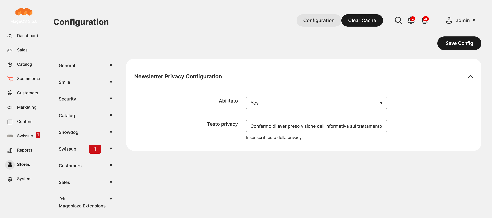
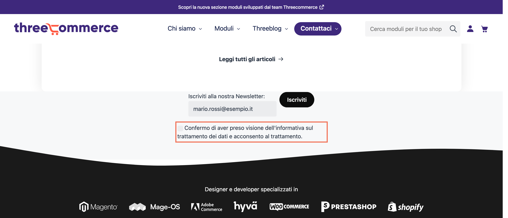

# Threecommerce_NewsletterPrivacy: privacy consent checkbox for the Magento 2 newsletter form

Magento 2 has no privacy checkbox in its newsletter subscription form. This free module adds one in the right place, overriding the base template cleanly, so you stay GDPR-compliant without touching core code.



**Compatibility:** Magento Open Source / Adobe Commerce 2.4.4 – 2.4.9 · Mage-OS 1.x / 3.x · PHP 8.1 – 8.4 · Themes: Luma, Hyvä, Breeze
**License:** free · **Current version:** see [Releases](../../releases)

## Features

- Adds a consent checkbox under the newsletter subscription form.
- Text and link to your privacy policy are editable from the admin.
- Stores the consent in the `privacy` column of `newsletter_subscriber` when the visitor subscribes (since 1.1.0).
- No manual template changes: everything is included.



## Requirements

- Magento Open Source / Adobe Commerce 2.4.4+ or Mage-OS
- PHP 8.1 – 8.4
- Native module: `Magento_Newsletter`
- Package: `threecommerce/m2-base` (installed automatically by Composer)

## Installation

The package is distributed through our Composer repository at `repo.threecommerce.it`. Request the credentials from the [product page](https://www.threecommerce.it/check-privacy-newsletter-per-magento-2?utm_source=github&utm_medium=readme&utm_campaign=magento2-newsletter-privacy-checkbox), then:

```bash
composer config repositories.threecommerce composer https://repo.threecommerce.it
composer require threecommerce/m2-privacynewsletter
bin/magento module:enable Threecommerce_NewsletterPrivacy
bin/magento setup:upgrade
bin/magento cache:flush
```

## Configuration

Admin → **Threecommerce Plugins → Newsletter Privacy Config**: enable the module and set the privacy text, including the link to your privacy policy.

## Documentation and support

- Product page: [threecommerce.it/check-privacy-newsletter-per-magento-2](https://www.threecommerce.it/check-privacy-newsletter-per-magento-2?utm_source=github&utm_medium=readme&utm_campaign=magento2-newsletter-privacy-checkbox)
- [Changelog](CHANGELOG.md) (in Italian)
- Support and custom development: [threecommerce.it/contatti](https://www.threecommerce.it/contatti?utm_source=github&utm_medium=readme&utm_campaign=magento2-newsletter-privacy-checkbox)

---

*This repository is the public showcase of the module. The source code is kept in a private repository.*
